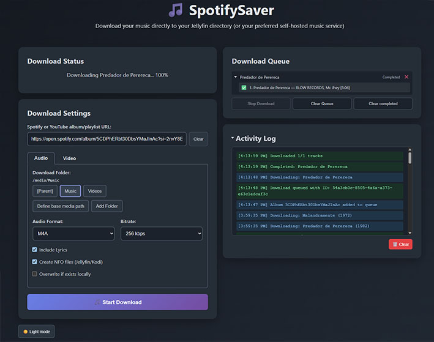

# SpotifySaver 🎵✨

[](https://www.python.org/)
[](https://pypi.org/project/spotifysaverdn/)
[](https://github.com/danilonishi/spotify-saver/pkgs/container/spotify-saver)
[](https://github.com/danilonishi/spotify-saver/pkgs/container/spotify-saver)
[](https://ffmpeg.org/)
[](https://github.com/yt-dlp/yt-dlp)
[](https://opensource.org/licenses/MIT)
[](https://github.com/psf/black)

[](https://developer.spotify.com/)
[](https://youtube.com/)
[](https://ytmusicapi.readthedocs.io/)
[](https://soundcloud.com)

> ⚠️This repository is a fork from gabrielbaute's SpotifySaver. It's being developed with quality of life features I missed when using his tool. You can easily see the changes made by clicking [here](https://github.com/gabrielbaute/spotify-saver/compare/main...danilonishi:spotify-saver:main).

All-in-one tool for downloading content for Jellyfin or similar media servers.

The app allows you to download content for your media server. It can connect to Spotify, Soundcloud and YouTube Music APIs, retrieve information, locate the media, download and extract the audio and/or video data and generate a Jellyfin-compatible .nfo file for libraries.

## Changes in this Fork

<p align="center">
    
</p>

This fork packs many more features compared to the baseline:

- **Server-managed download queue:** Downloads continue if you refresh or close the browser.
- **Access control:** Protected UI and API to avoid unauthorized access.
- **Video support:** Downloads videos with configurable format, resolution and quality and generates NFO metadata.
- **SoundCloud support:** Direct downloads when download option is available.
- **Silence Trimming:** Option to automatically trim silence at the start and end of downloaded audio files.
- **Playlist support:** Download playlists from Spotify and YouTube.
- **Multiple parallel Downloads:** Useful when downloading large playlists or albums.
- **Channel Watcher:** Schedule channel checks and automatically download new uploads.
- **Jellyfin library scans:** Automatically triggers Jellyfin media scan after downloads are completed.
- **[Browser extension support](https://github.com/danilonishi/spotifyu-saver-browser-extension):** Trigger downloads from Spotify, YouTube, and SoundCloud pages, or watch channels.
- **Simplified download folders:** Browse and select download folders in the web interface.
- **UI improvements:** Dark mode and customizable interface.
- **Backup and restore:** Easier to migrate the server or share configurations.
- **Storage safeguards:** Set a minimum free space to avoid completely filling the storage.
- **Improved visibility:** Downloads are reported by the server to all connected clients.
- **Large Spotify playlists:** Large playlists were capped due to Spotify list being paginated. This is fixed here.
- **Overwrite control:** Keep existing files by default (skipping download), or choose to redownload and overwrite.
- **Notifications:** Browser and toaster notifications for events are available.
- **Download queue controls:** Pause/resume the queue and retry failed downloads.
- **Channel Watcher controls and filters:** Filter out uploads by keywords, duration, date, Shorts, and livestreams.


## 🌟 Features

|  | Feature                  | Description                                |
|--------|--------------------------|--------------------------------------------|
||**General**||
| ✅ | Organization | Automatic folder structure: Artist/Album/Track or Channel/Video|
| ✅ | Metadata | Generate Jellyfin-compatible `.nfo` metadata for audio and video|
| ✅ | Audio Formats | M4A, MP3 and OPUS|
| ✅ | Audio Bitrates | 96, 128, 192 and 256 kbps|
| ✅ | Video Formats | MP4, MKV and WebM|
| ✅ | Video Resolution | 360p, 480p, 720p, 1080p, 1440p and 2460p (4K)|
||**Youtube/Youtube Music**||
| ✅ | Download | Download audio or video|
| ✅ | Playlists / Album Collections | Download and generate playlist file |
| ✅ | Channel Watcher | Watch channel and automatically downloads new content |
| ✅ | video with chapter markers | Not supported|
| ❌ | Lyrics | Youtube does not support Lyrics.  Captions-to-Lyrics is planned|
| ❌ | Captions | Planned|
||**Spotify**||
| ✅ | Tracks | Fetch metadata from Spotify and audio track from Youtube Music|
| ✅ | Playlists | Download tracks and saves playlist file|
| ✅ | Lyrics | Synchronized lyrics (.lrc) from LRC Lib|
| ❌ | Artist Watcher | Planned |
||**Soundcloud**||
| ✅ | Tracks | Direct download when available, Youtube Music as fallback|
| ❌ | Playlists | Planned |
| ❌ | Lyrics | Soundcloud does not support lyrics|
| ❌ | Artist Watcher | Planned |
||**Browser Extension**||
| ✅ | API | Adapts interface when download is requested by browser extension|
||**Settings**||
| ✅ | UI | Control panel visibility|
| ✅ | Notifications | Enable browser and toaster notifications for events|
| ✅ | Storage | Define minimum free space for downloads|
| ✅ | Download limiter | Set number of simultaneous downloads and bandwidth|
| ✅ | Confirmation | Option to confirm queued downloads before they start downloading|
| ✅ | Backup & Restore | Generates `.json` file with server and client settings|
| ✅ | Jellyfin | Option to trigger library scan after all downloads are finished|
| ✅ | Spotify | Set up credentials to access the Spotify API|
| ✅ | Security | Password management|


# Installation

### Requirements
- Python 3.10+
- FFmpeg
- [Spotify Developer Account](https://developer.spotify.com/dashboard/) (only for Spotify URL downloads)

##

You can install using one of the three methods listed below.

### Method 1: Docker  (recommended)
See [Docker support with auto-builds](#-docker-support)

### Method 2: Poetry (through Git)
```bash
git clone https://github.com/danilonishi/spotify-saver.git
cd spotify-saver
poetry install
poetry run spotifysaver-api
```
Leave the server running, then proceed to [First-time sign-in](#first-time-sign-in).

### Method 3: Pip (through Git)
```bash
pip install git+https://github.com/danilonishi/spotify-saver.git
spotifysaver-api
```
Leave the server running, then proceed to [First-time sign-in](#first-time-sign-in).

## 🐳 Docker Support

Docker images are published to
[GitHub Container Registry](https://github.com/danilonishi/spotify-saver/pkgs/container/spotify-saver)
from pushes to `main` and version tags (`v*`). `latest` tracks `main`; version
tags are also available for pinned deployments. The first successful workflow
run creates the package. Set its visibility to **Public** in GitHub Packages
if servers should be able to pull images without authenticating. Until the
first publish workflow has succeeded, use the local-build override below.

### Install with Docker Compose

Requirements: Docker Engine/Desktop with the Compose plugin. Clone this
repository, then create the host folders and environment file:

In **Windows PowerShell**, run:

```powershell
New-Item -ItemType Directory -Force data\music, data\videos, data\config
Copy-Item .env.docker.example .env
```

On **Linux/macOS**, run the equivalent commands in a terminal using Bash:

```sh
mkdir -p data/music data/videos data/config
cp .env.docker.example .env
```

The container runs as user ID `1000` and needs write access to its config
folder. If you created the repository or its data folders with `sudo`, fix
ownership before starting the container:

```sh
sudo chown -R 1000:1000 data/config
```

If you set `CONFIG_DIR` in `.env` to a different host folder, use that folder
instead of `data/config`.

Before starting SpotifySaver, edit `.env` and set `MUSIC_DIR` and `VIDEO_DIR`
to the existing media folders on your server. For example, if your media
folders are `/media/Music` and `/media/Videos`, set:

```dotenv
MUSIC_DIR=/media/Music
VIDEO_DIR=/media/Videos
```

These are host paths, not the `/music` and `/videos` paths used inside the
container. Leave `CONFIG_DIR=./data/config` unless you want to store the app's
configuration elsewhere. On Linux, you can edit the file with `nano .env` from
the repository folder.

Direct YouTube downloads and the Channel Watcher do not need Spotify
credentials. Spotify URL-based downloads can be configured from **Settings →
Spotify Account** after signing in. The app asks Spotify to authorize in your
browser and receives the callback on the server; this works with a headless
Docker deployment.

Start the published image:

```sh
docker compose pull
docker compose up -d
```

## First-time sign-in

On first launch, SpotifySaver writes a one-time administrator setup token to
the server logs.

| Installation Method | Step |
|---------------------|--------------------------------|
| Poetry / Pip | Find the token in the terminal where you started `spotifysaver-api`.|
| Docker Compose | run ```sh docker compose logs --tail=100 spotifysaver``` from the directory containing the Compose files.|

Find the line beginning `First-run administrator setup token` and enter its
token in the setup page. If the Docker container is restarting, use the same
command to inspect the startup error in the logs.

Open `http://{Server-Address}:8000` (127.0.0.1 for localhost, IP of target machine,
or reverse-proxy address) in your browser, enter the token, and create an
administrator password of at least 12 characters. The token is generated again
after a server restart until the initial password has been set, and becomes
invalid once it is used. Do not share the logs while they contain the token.
After setup, sign in with the password you created. Login attempts are
rate-limited.

The admin password, sessions, and Spotify app credentials are persisted in
`CONFIG_DIR` (the `data/config` folder by default); the database is readable
only by the container account on Linux. The Spotify OAuth token cache is stored
in the same config directory with restricted file permissions. Back up this
directory and protect access to it.


## Configure Spotify

1. Create an app in the [Spotify Developer Dashboard](https://developer.spotify.com/dashboard/).
2. In SpotifySaver, open **Settings → Spotify Account**. Copy the displayed
   OAuth redirect URL into the app's allowed Redirect URIs in the Spotify
   Developer Dashboard. It must match exactly; for a Caddy deployment it uses
   the public HTTPS hostname.
3. Enter the app's Client ID and Client Secret and save them.
4. Select **Connect to Spotify** and approve access in Spotify.

The Client Secret is stored on the server and is never returned to the browser
after saving. The server-side security database is protected by filesystem
permissions, not encrypted; anyone with access to the server's config files or
Docker administrator access can read it. Keep those host files private.

To build and run the checked-out source instead of pulling GHCR, add the build
override:

```sh
docker compose -f docker-compose.yml -f docker-compose.build.yml up -d --build
```

### CLI

If you're unable to browse to the settings view, run this command to save configuration to `~/.spotify-saver/.env`:

```bash
spotifysaver init
```
The app also checks for a `.env` file in the project directory as a fallback.
Supported environment variables include:

| Variable                  | Description                                | Default Value                     |
|---------------------------|--------------------------------------------|-----------------------------------|
| `SPOTIFY_CLIENT_ID`       | ID of the Spotify app you created          | -                                 |
| `SPOTIFY_CLIENT_SECRET`   | Secret key generated for your Spotify app  | -                                 |
| `SPOTIFY_REDIRECT_URI`    | Spotify app redirect URI                   | `http://127.0.0.1:8888/callback`  |
| `SPOTIFYSAVER_OUTPUT_DIR` | Audio download directory                   | `Music`                                      |
| `SPOTIFYSAVER_VIDEO_DIR`  | Video download directory                   | `Videos`                                     |
| `YTDLP_COOKIES_PATH`      | YouTube cookies file path (optional; for Docker, use a path inside the container such as `/config/cookies.txt`) | - |
| `SPOTIFY_AUTH_CACHE_PATH` | Spotify authorization cache path           | `~/.spotify-saver/.spotify-cache`            |
| `SPOTIFY_SCOPES`          | Spotify permissions requested              | `playlist-read-private playlist-read-collaborative` |
| `LOG_LEVEL`               | Logging level                              | `info`                                       |

The `init` wizard also writes `API_PORT` and `API_HOST`, but the standalone
server currently uses port `8000` and host `0.0.0.0`. For an example
configuration file, see [`.env.example`](.env.example).

# Updating

## Git/Poetry

For a source checkout installed with Poetry, update the checkout and reinstall:

```sh
git pull
poetry install
```

## Git/Pip

If installed from Git with pip, upgrade from the repository:

```sh
python -m pip install --upgrade "git+https://github.com/danilonishi/spotify-saver.git"
```

Restart the SpotifySaver server after updating.

## Docker

For Docker, update to the latest published `main` image by running `git pull`
for the Compose files, then pull and start the service.

If Caddy runs in Docker, include the Caddy override on **both** commands so the container stays attached to Caddy's shared network:

```sh
docker compose -f docker-compose.yml -f docker-compose.caddy.yml pull
docker compose -f docker-compose.yml -f docker-compose.caddy.yml up -d
```

If you do **not** use the Docker Caddy override (for example, Caddy runs on the
host), use the base Compose file:

```sh
docker compose pull
docker compose up -d
```

Docker images are published as latest when changes are pushed to main. To publish a versioned release image, push a new Git tag using the vX.Y.Z format (for example, v0.7.6). The workflow publishes versioned and major/minor tags. To pin your deployment to that release, set IMAGE_TAG=0.7.6 in .env instead of using latest.

Open `http://127.0.0.1:8000`. The API is also available at
`http://127.0.0.1:8000/docs`. The port is bound to loopback only; for access
over HTTPS or from other devices, configure a reverse proxy rather than
exposing the application port directly. See the optional
[Caddy reverse proxy guide](CADDY.md).

The UI's folder selectors operate on container paths. Audio downloads are
stored under `/music`, video and watched-channel downloads under `/videos`,
and both paths map to `data/music` and `data/videos` on the host by default.
You can set `MUSIC_DIR`, `VIDEO_DIR`, and `CONFIG_DIR` in `.env` to change the
host-side folders. Keep the config directory: it stores the watched-channel
database, channel download archives, cookies, and other home-directory app
state. Back up these folders before migrating or reinstalling:

```text
data/music/
data/videos/
data/config/
```

On Linux, make sure the mounted directories are writable by the container's
non-root user (UID 1000). For example, if these are dedicated directories:

```sh
sudo chown -R 1000:1000 data/music data/videos data/config
```

Useful maintenance commands for a deployment without the Docker Caddy override:

```sh
docker compose logs -f spotifysaver
git pull
docker compose pull
docker compose up -d
docker compose down
```

For a Docker Caddy deployment, add
`-f docker-compose.yml -f docker-compose.caddy.yml` to each `docker compose`
command instead. Omitting the override can detach SpotifySaver from Caddy's
network when Compose recreates the container.

`docker compose down` stops and removes the container but leaves the bind
mounted data folders and named log volume intact. Do not use
`docker compose down -v` unless you intend to remove the named log volume as
well.

## Cookies

Cookies are disabled by default. **Only configure `YTDLP_COOKIES_PATH` if a video
requires authentication**, and use a fresh export: stale or incompatible YouTube
cookies can cause downloads to fail with HTTP 403. For Docker Compose, save the
cookies file under the configured `CONFIG_DIR` on the host (by default,
`./data/config/cookies.txt`) and set this in `.env`:

```dotenv
YTDLP_COOKIES_PATH=/config/cookies.txt
```

To disable cookies, remove or empty `YTDLP_COOKIES_PATH` in `.env`, then
recreate the container with `docker compose up -d --force-recreate spotifysaver`.
To back up or replace the file first, use the host path, for example:

```bash
cp ./data/config/cookies.txt ./data/config/cookies.txt.backup
```

Do not share the cookie file; it contains session credentials. If the cookie
file is not present in your configured `CONFIG_DIR`, leave the setting disabled.

# 📚 Documentation

The **documentation for using the API**, on the other hand, can be found in this same repository here: [API Documentation](API_IMPLEMENTATION_SUMMARY.md)

## 💻 Using the CLI

### Available Commands

| Command              | Description                                | Example                                    |
|----------------------|--------------------------------------------|--------------------------------------------|
| `init`               | Configure environment variables            | `spotifysaver init"`                       |
| `download [URL]`     | Download Spotify tracks/albums/playlists or YouTube albums/playlists | `spotifysaver download "URL"`      |
| `inspect`            | Shows Spotify metadata (album, playlist)   | `spotifysaver inspect "URL_SPOTIFY"`       |
| `show-log`           | Shows the application log                  | `spotifysaver show-log`                    |
| `version`            | Shows the installed version                | `spotifysaver version`                     |

### Download Options

| Option            | Description                                           | Accepted Values         ​​|
|-------------------|-------------------------------------------------------|-------------------------|
| `--lyrics`        | Download synchronized lyrics (.lrc)                   | Flag (no value)         |
| `--output DIR`    | Output directory                                      | Valid path              |
| `--format FORMAT` | Audio format                                          | `m4a` (default), `mp3`, `opus` |
| `--bitrate KBPS`  | Audio bitrate                                         | `96`, `128` , `192`, `256`(default) |
| `--cover/--no-cover` | Save Spotify cover or embed YouTube thumbnail | Flag (no value)      |
| `--nfo`           | Generates a .nfo metadata file in the JellyFin format | Flag (no value)         |
| `--explain`       | Show score breakdown for each track without downloading (for error analysis) | Flag (no value)         |
| `--dry-run`       | Simulate download without saving files                | Flag (no value)         |

### show-log Options

| Option      | Description                             | Accepted Values ​​              |
|-------------|-----------------------------------------|-------------------------------|
| `--lines`   | Number of log lines to display          | `--lines 25` --> `int`        |
| `--level`   | Filter by log level                     | INFO, WARNING, DEBUG, ERROR   |
| `--path`    | Displays the location of the log file   | Flag (no value)               |

## 💡 Usage Examples
```bash
# Set spotifysaver configuration
spotifysaver init

# Download album with synchronized lyrics
spotifysaver download "https://open.spotify.com/album/..." --lyrics

# Download album with metadata file; the cover is saved as cover.jpg by default
spotifysaver download "https://open.spotify.com/album/..." --nfo

# Download song in MP3 format
spotifysaver download "https://open.spotify.com/track/..." --format mp3

# Download a YouTube Music album or playlist with YouTube-provided tags
spotifysaver download "https://music.youtube.com/playlist?list=..."
```

The CLI accepts Spotify tracks, albums, and playlists, and YouTube playlists or album collections. Direct YouTube video URLs are supported by the web interface and API, but not by the CLI. Spotify playlist tracks are saved under their canonical artist/album folders, with playlist files kept separately in a `Playlists/` directory beside the configured output directory. Existing files are skipped by default; set the web interface's overwrite option or the API's `overwrite_existing` field to replace them.

## Usage with API

To use the API, you need to have the API server running. You can start it with the following command:

```bash
# Start the API server
spotifysaver-api
```

The server will run at `http://127.0.0.1:8000` by default. The API accepts Spotify track, album, and playlist URLs, as well as direct YouTube video and collection URLs. Active downloads can be cancelled with `POST /api/v1/download/{task_id}/cancel`. You can find the [API documentation here](API_IMPLEMENTATION_SUMMARY.md), which describes the technical aspects and usage in detail.

## 🖥️ Web Interface (UI)

Start the API server with web interface
```bash
spotifysaver-api
```

This will start the API server with an integrated web interface.
You can access at `http://127.0.0.1:8000` from the same machine or replace by your target ip or reverse-proxy address.

**Default Access:** (replace by your)
- Web Interface & API: `http://{address}:8000`
- API Documentation: `http://{address}:8000/docs`

The web interface and API **require an administrator password**. On first startup,
the server logs a one-time setup token; enter it in the browser to create the
password. Store and protect the server's configuration directory because it
contains the password hash, Spotify credentials, and authorization tokens.
Use **HTTPS** for remote access.

In **Settings → Backup & Restore**, download a JSON configuration backup before
migrating or reinstalling. The file includes watched channel URLs and server
paths, so keep it private. Restoring replaces the included settings on the
current instance. Passwords, Jellyfin API keys, Spotify client secrets, and
Spotify authorization tokens, active downloads, per-video watcher history, and
activity logs are not transferred; re-enter secrets and reconnect Spotify on
the destination if needed. Review media folder paths after restoring because
host and container paths can differ.

## 📂 Output Structure
```
.
├── Music/
│   ├── Artist/
│   │   └── Album (Year)/
│   │       ├── 01 - Song.mp3
│   │       ├── 01 - Song.lrc
│   │       ├── album.nfo
│   │       └── cover.jpg
│   └── YouTube/
│       └── Collection Name/
│           └── 01 - Video Title.mp3
├── Videos/
│   └── Channel Name/
│       └── Video Title.mp4
└── Playlists/
    └── Playlist Name/
        └── Playlist Name.m3u
```
Videos are saved under a folder named for the YouTube channel or uploader within
the selected video folder (default: `Videos`). Playlist video filenames include
their position in the playlist, such as `01 - Video Title.mp4`.

## 🤝 Contributions
1. Fork the project
2. Create your branch (`git checkout -b feature/new-feature`)
3. Commit your changes (`git commit -m 'Add awesome feature'`)
4. Push to the branch (`git push origin feature/new-feature`)
5. Open a Pull Request

## 📄 License

MIT © [TGabriel Baute](https://github.com/gabrielbaute)
